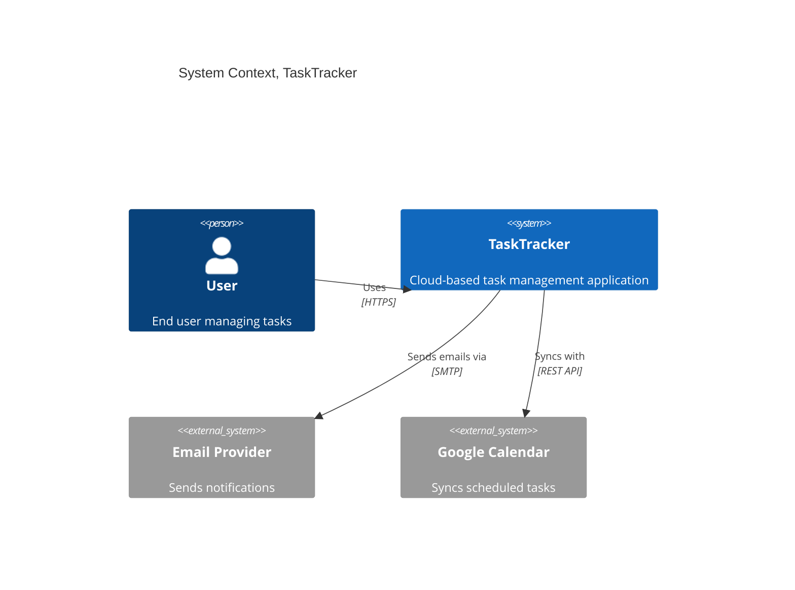

# Modelo C4

> **TL;DR.** Documente arquitetura em **quatro níveis de zoom**: Context (sistema no mundo), Container (peças executáveis), Component (módulos dentro de uma peça) e Code (classes, se necessário). Pragmático, fácil de explicar, suficiente para a maioria dos sistemas.

## O quê

**C4 Model** é uma técnica de visualização de arquitetura criada por **Simon Brown** em 2011 ([c4model.com](https://c4model.com)). Propõe **quatro tipos de diagramas hierárquicos**, do mais abstrato ao mais detalhado:

| Nível | Foco | Audiência | Frequência de mudança |
|---|---|---|---|
| **1. Context** | O sistema e seus usuários/sistemas externos | Todos (tech + business) | Raramente |
| **2. Container** | Os "deployables", apps, APIs, bancos, filas | Devs e ops | Ocasional |
| **3. Component** | Módulos dentro de um container | Devs do container | Comum |
| **4. Code** | Classes / detalhes de implementação (opcional) | Devs no detalhe | Sempre, geralmente gerado, não desenhado |

Os níveis funcionam como **zoom**: você começa no mais alto e desce conforme precisa de detalhe.

## Por quê

UML virou um pântano: muitos tipos de diagrama, notação prolixa, ferramentas pesadas. Como resultado, equipes pararam de documentar arquitetura, ou documentaram com diagramas idiossincráticos sem padrão.

C4 acerta no balanço:

- **Poucos tipos de diagrama**: quatro, e o último é opcional.
- **Notação simples e consistente**: qualquer um lê sem treinamento.
- **Diagrama-como-código**: ferramentas como [Structurizr](https://structurizr.com): Mermaid, PlantUML geram a partir de texto versionável.
- **Múltiplas audiências**: o nível 1 é para a área de produto/business; o nível 3 é para desenvolvedor que vai mexer.

> "C4 is a 'static diagrams for software architecture' approach... abstractions over the diagrams that you can see."
> (Simon Brown)

## Como aplicar

### Os 4 níveis (com exemplo)

Imagine um sistema "TaskTracker", um app de gerenciamento de tarefas.

#### 1) System Context Diagram

Mostra o **sistema como uma caixa preta**, com os usuários e os sistemas externos com os quais interage.

```
   ┌──────────┐                            ┌─────────────────────┐
   │   User   │ ─── usa ─────────────────→ │    TaskTracker      │
   └──────────┘                            │     (System)        │
                                           └─────────────────────┘
                                                  │       │
                                                  │       │
                                                  ▼       ▼
                                      ┌──────────────┐  ┌──────────────┐
                                      │   Email      │  │  Google      │
                                      │   Provider   │  │  Calendar    │
                                      │   (External) │  │  (External)  │
                                      └──────────────┘  └──────────────┘
```

**Audiência:** todos, incluindo gerência, produto, jurídico. Não tem detalhe técnico.

**Conteúdo típico:**
- Pessoas / personas que usam o sistema.
- Sistemas externos integrados.
- Direção e propósito de cada integração.

#### 2) Container Diagram

Expande a caixa preta. Mostra os **containers**: aplicações e armazenamentos de dados que rodam separadamente.

> "Container" aqui não significa Docker. Significa "algo que precisa rodar para o sistema funcionar", uma webapp, uma API, um banco, uma fila.

```
   ┌──────────┐
   │   User   │
   └────┬─────┘
        │ HTTPS
        ▼
   ┌────────────────────┐        ┌────────────────────┐
   │   Web Application  │ ─────→ │     API Service    │
   │   (React)          │ JSON   │     (Node.js)      │
   └────────────────────┘        └────────┬───────────┘
                                          │ SQL
                                          ▼
                                 ┌────────────────────┐
                                 │     Database       │
                                 │     (Postgres)     │
                                 └────────────────────┘
```

**Audiência:** desenvolvedores, ops.

**Conteúdo típico:**
- Cada container nomeado, com sua tecnologia entre parênteses.
- Protocolos de comunicação entre containers.
- Bancos, filas, caches.

#### 3) Component Diagram

Expande **um container**: mostra os componentes internos e como interagem.

```
                  API Service (Node.js)
   ┌─────────────────────────────────────────────────────┐
   │                                                     │
   │   ┌─────────────────┐         ┌──────────────────┐  │
   │   │   Auth          │         │   Tasks          │  │
   │   │   Controller    │ ─uses─→ │   Service        │  │
   │   └─────────────────┘         └──────┬───────────┘  │
   │                                      │              │
   │   ┌─────────────────┐                ▼              │
   │   │   Tasks         │         ┌──────────────────┐  │
   │   │   Controller    │ ───────→│  Tasks Repo      │  │
   │   └─────────────────┘         └──────┬───────────┘  │
   │                                      │              │
   └──────────────────────────────────────┼──────────────┘
                                          ▼
                                  ┌──────────────┐
                                  │  Database    │
                                  └──────────────┘
```

**Audiência:** desenvolvedores que trabalham no container.

**Conteúdo típico:**
- Módulos / componentes do container.
- Responsabilidade resumida de cada um.
- Dependências entre eles.

#### 4) Code Diagram (opcional)

Diagrama de classes UML ou similar. Frequentemente **gerado pela IDE/ferramenta**, não desenhado à mão. Use só quando o nível 3 não basta.

Para a maioria dos sistemas, os níveis 1–3 cobrem o que precisa. O nível 4 vira "ruído versionado" se você o cria à mão.

### Notação: o suficiente

C4 não prescreve notação rígida. Recomendações:

- Cada caixa tem **nome**, **tipo** (Person / Software System / Container / Component) e **tecnologia** entre parênteses quando aplicável.
- Setas têm **rótulo** descritivo (`Faz HTTP REST calls a`, `Lê e escreve de`).
- Estilos visuais distinguem tipos (pessoa = stick figure; sistema externo = cor diferente).
- Use **cores e formas com consistência**. Crie uma legenda.

### Ferramentas

- **[Structurizr](https://structurizr.com)**: criação textual (DSL), renderização web. Versionável em Git.
- **[Mermaid](https://mermaid.js.org/syntax/c4.html)**: suporte experimental a C4. Renderiza nativamente no GitHub.
- **[PlantUML](https://plantuml.com/stdlib#c4)**: biblioteca C4-PlantUML; integra com qualquer pipeline.
- **[Likec4](https://likec4.dev)**: DSL moderna inspirada em Structurizr.
- **draw.io / Excalidraw**: opções de desenho livre quando texto não basta.

### Exemplo em Mermaid (renderiza no GitHub)



### Boas práticas

- **Mantenha versionado.** Diagrama vive em `docs/architecture/` no repositório, atualizado por PR como qualquer código.
- **Comece pelo nível 1.** Não desenhe Component sem Context e Container. Sem o contexto maior, o detalhe perde sentido.
- **Não diagrame tudo.** Só o que precisa ser comunicado. Detalhes voláteis e não-críticos não merecem documentação.
- **Atualize ou apague.** Diagrama desatualizado é pior que ausência de diagrama, confunde com confiança falsa.
- **Múltiplas vistas, mesmo modelo.** Ferramentas como Structurizr permitem **um modelo único** com várias **views**. Mude o modelo uma vez; todos os diagramas atualizam.

## Quando *não* usar

- **Projetos solo / scripts.** A formalização não se paga.
- **Como substituto de conversa.** Diagramas explicam *o quê*; mudanças importantes ainda precisam de discussão.
- **Para escrever ADRs.** Os dois se complementam: o diagrama mostra **como é**; o ADR explica **por que decidimos assim**. Veja [ADRs](./architecture-decision-records.md).
- **No detalhe extremo.** C4 é macro/médio. Para sequência de chamadas, use sequence diagram UML.

## Conceitos relacionados

- [ADRs](./architecture-decision-records.md), documentam o **porquê** das decisões.
- [Documentação](../collaboration/documentation.md), onde C4 se encaixa na cadeia de docs.
- [Microsserviços](./microservices.md): Container diagrams são valiosos para visualizar sistemas distribuídos.

## Referências

- **Site oficial.** [c4model.com](https://c4model.com). Documentação de Simon Brown.
- **Livro.** Simon Brown, *Software Architecture for Developers* (Leanpub, em atualização contínua). Cobre C4 em profundidade.
- **Palestra.** Simon Brown, ["The Art of Visualising Software Architecture"](https://www.youtube.com/watch?v=x2-rSnhpw0g). Boa intro em 1 hora.
- **Site.** [Structurizr](https://structurizr.com). Ferramenta oficial.
- **Artigo.** Simon Brown, ["The C4 model for visualising software architecture"](https://www.infoq.com/articles/C4-architecture-model/) (InfoQ, 2018).
- **Documentação.** [C4-PlantUML](https://github.com/plantuml-stdlib/C4-PlantUML). Biblioteca para PlantUML.
- **Documentação.** [Mermaid C4 docs](https://mermaid.js.org/syntax/c4.html).
